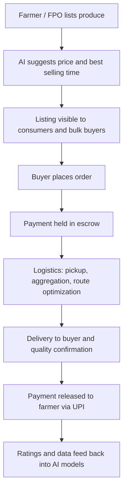
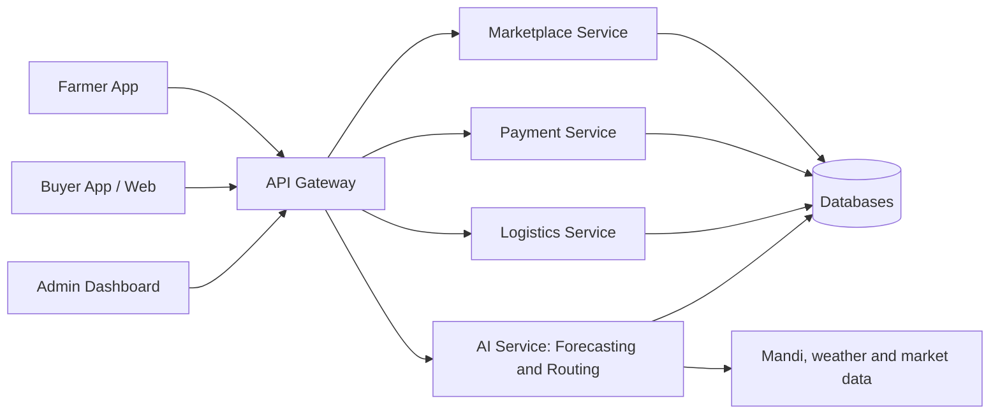

# Smart India Hackathon Workshop
# Date: 24/10/2026
## Reference Number: 26018171
## Name: Kiran Kumar V

## Problem Title
SIH 26033: Multiple intermediaries reduce farmers earnings and increase consumer prices.

## Problem Creater's Organization
Ministry of Consumer Affairs, Food & Public Distribution

## Theme
Agriculture, FoodTech & Rural Development

## Problem Description
Expected Solution: Create a digital marketplace that:

• Connects farmers/FPOs directly with consumers and bulk buyers.
• Provides logistics support.
• Uses AI for demand forecasting and route optimization.

Benefits:

• Better prices for farmers.
• Lower prices for consumers.
• Reduced supply chain inefficiencies.

## Proposed Solution
**1. Detailed explanation of the proposed solution**

*FarmDirect* is a mobile-first digital marketplace that lets farmers and Farmer Producer Organizations (FPOs) sell produce straight to consumers, retailers, restaurants and bulk buyers, without layers of middlemen.

- **Farmer/FPO app:** Farmers list produce (crop, grade, quantity, harvest date, photos) in their local language, using voice input and a simple UI. Prices are suggested from live mandi data and AI forecasts.
- **Buyer app and web portal:** Consumers can order fresh produce in small quantities, while bulk buyers (hotels, retailers, processors) can place scheduled or contract orders and run reverse auctions.
- **Logistics layer:** Village-level collection points aggregate produce, and partnered transporters carry it to city hubs or directly to buyers. Cold-chain options are offered for perishables.
- **AI engine:** Forecasts demand and price trends, recommends what and when to sell, and optimizes pickup and delivery routes.
- **Transparent payments:** Buyer payment is held in escrow and released to the farmer's bank account via UPI on confirmed delivery. A price-breakdown screen shows how much of the buyer's payment reaches the farmer.

**2. How it addresses the problem**

| Problem | How FarmDirect addresses it |
|---|---|
| Multiple intermediaries take margins | Direct farmer/FPO-to-buyer listing and ordering removes most commission layers |
| Farmers lack price information | Live mandi prices and AI price suggestions give farmers negotiating power |
| Mismatch between supply and demand causes wastage | Demand forecasting guides what to grow and when to harvest and sell |
| Poor logistics and high transport cost | Aggregation, shared loads and route optimization cut cost per kg |
| Delayed or unfair payments | Escrow-based UPI payments with settlement on delivery |

**3. Innovation and uniqueness of the solution**

- Combines marketplace, logistics and AI forecasting in a single platform, rather than only a listing site.
- Voice-first, multilingual interface designed for low-literacy and low-bandwidth rural users.
- FPO-centric aggregation so small and marginal farmers can serve bulk buyers.
- Price transparency dashboard showing the farmer's share of the final consumer price.
- Demand-based crop advisory that lets farmers plan ahead of the season.
- Shared-load route pooling that reduces last-mile cost.

## Technical Approach

**1. Technologies to be used**

- **Frontend:** React Native (Android/iOS farmer and buyer apps), React.js (admin and bulk buyer web portal)
- **Backend:** Node.js with Express (or Python FastAPI for ML services), REST APIs
- **Database:** PostgreSQL (orders, users, transactions), MongoDB (listings and logs), Redis (caching)
- **AI/ML:** Python, scikit-learn, Prophet/LSTM for demand and price forecasting; Google OR-Tools for route optimization (vehicle routing)
- **Language and voice:** Speech-to-text and translation APIs (e.g. Bhashini) for regional languages
- **Maps and logistics:** OpenStreetMap or Google Maps API for tracking and routing
- **Payments:** UPI / payment gateway with escrow-style settlement
- **Data sources:** Agmarknet and e-NAM mandi prices, IMD weather data, historical market arrivals
- **Cloud and DevOps:** Docker, AWS / Azure, GitHub Actions for CI/CD
- **Security:** JWT authentication, OTP login, role-based access, HTTPS and data encryption

**2. Methodology and process for implementation**

1. Requirement study with farmers, FPOs and buyers, and collection of mandi price datasets.
2. Design of the database schema, APIs and UI wireframes.
3. Development of the farmer app, buyer app and admin dashboard.
4. Training and validation of the demand and price forecasting models.
5. Integration of payments, logistics and the route optimization engine.
6. Pilot in a few villages or an FPO cluster, then feedback and improvement.
7. Scale-up to more districts and crops.

**Process flow**

**System architecture**

*Working prototype / screenshots: to be added here.*

## Feasibility and Viability

**1. Analysis of the feasibility of the idea**

- **Technical:** Every component (mobile apps, UPI payments, ML forecasting, route optimization) uses mature, widely available technology and open datasets.
- **Operational:** FPOs already aggregate produce, so the platform builds on existing farmer groups and can start in a limited region.
- **Economic:** Revenue can come from a small transaction fee (much lower than the traditional commission), logistics margin and premium analytics for bulk buyers.
- **Social:** High smartphone and UPI penetration in rural India, along with government support for FPOs and digital agriculture, makes adoption realistic.

**2. Potential challenges and risks**

- Low digital literacy and connectivity in rural areas
- Farmers' habit of depending on traditional traders and informal credit
- Last-mile logistics cost and cold-chain availability
- Quality assurance and grading disputes
- Trust and payment security
- Balancing supply and demand in the early stage (cold start)

**3. Strategies for overcoming these challenges**

- Voice-based, regional-language UI, offline-capable app, and training through FPOs and village-level agents
- Pilot with FPOs first and offer early incentives such as zero commission for initial sales
- Shared-load logistics, village collection points and partnerships with local transporters and cold storage
- Standard grading guidelines, photo and quality checks at pickup, and a rating and dispute-resolution system
- Escrow payments and KYC verification for all users
- Focus on a few high-volume crops and a single district cluster before scaling

## Impact and Benefits

**1. Potential impact on the target audience**

- **Farmers/FPOs:** Higher realized price per kg, timely payments, better price information and a wider market.
- **Consumers:** Fresher produce at lower prices, with transparent pricing.
- **Bulk buyers:** Reliable, traceable supply and predictable quantities.
- **Government:** Better visibility of supply chains, price trends and support for FPO schemes.

**2. Benefits of the solution**

- **Economic:** Greater farmer income, lower consumer prices, reduced transaction costs, and new jobs in logistics and aggregation.
- **Social:** Empowers small and marginal farmers and women-led FPOs, and improves digital inclusion in rural areas.
- **Environmental:** Less food wastage through demand forecasting, fewer empty trips and shorter routes through optimization, and lower transport emissions.
- **Supply chain efficiency:** Fewer handling stages, faster delivery and better price discovery.

## Research and References

1. e-NAM (National Agriculture Market): https://enam.gov.in
2. Agmarknet, mandi price and arrival data: https://agmarknet.gov.in
3. Open Network for Digital Commerce (ONDC): https://ondc.org
4. Small Farmers' Agribusiness Consortium (SFAC), FPO promotion scheme: https://sfacindia.com
5. Google OR-Tools, vehicle routing problem: https://developers.google.com/optimization/routing
6. Prophet, time-series forecasting: https://facebook.github.io/prophet/
7. Bhashini, Indian language AI services: https://bhashini.gov.in
